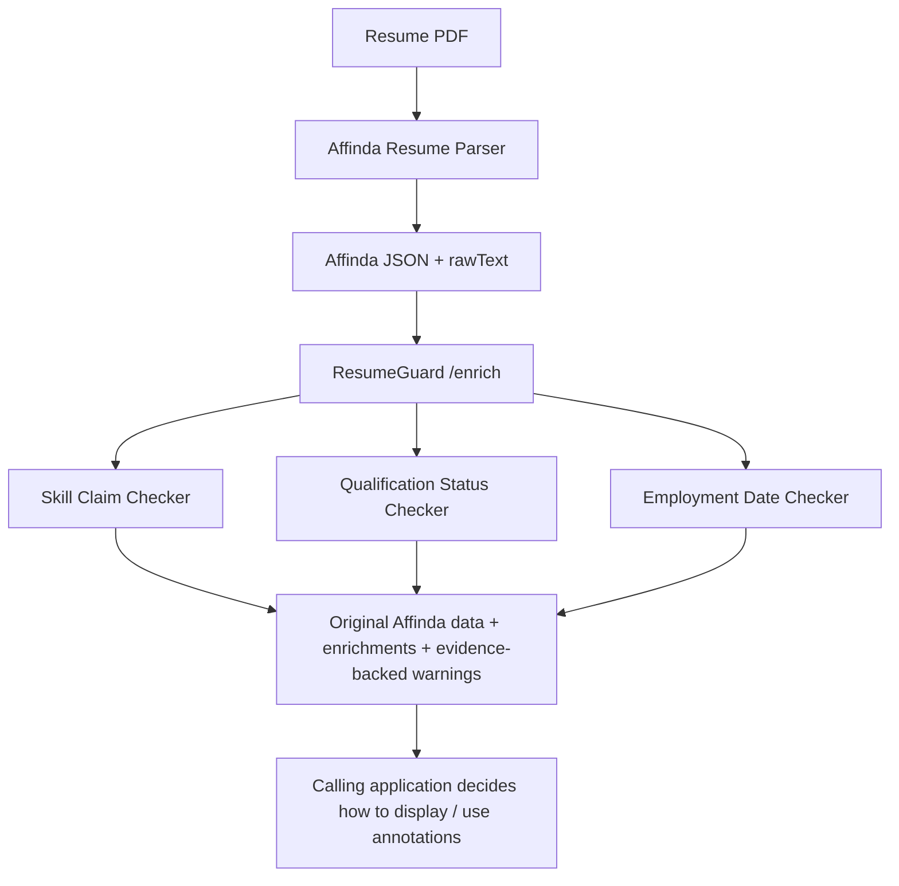

# ResumeGuard — Rough Scope (Early Planning)

> **Status: early planning document, not a technical specification.**
> This records *what* we intend to build and *why*, based on four rounds of testing. It
> deliberately avoids final architecture, framework, or model decisions. No code is written
> at this stage. Working name: **ResumeGuard**.

---

## 1. Project Summary

**ResumeGuard** is a lightweight, modular API adapter that sits *alongside* Affinda's Resume
Parser and enriches its structured JSON output. It is **not** a resume parser, and **not** a
replacement for or competitor to Affinda — it depends on Affinda's parser doing the heavy
lifting of extraction.

ResumeGuard takes the parser's existing JSON (plus the extracted `rawText` where available),
runs a small set of focused checks, and returns:

- the **original Affinda output, unchanged**, plus
- **separate, structured enrichments** (e.g. a skill marked as explicitly denied, an
  education entry given a completion status), and
- **evidence-backed warnings** — each finding points back to the text in the resume that
  prompted it.

The calling application decides how to display or act on those annotations. The core promise
is simple: **preserve important resume information more accurately, without redesigning the
underlying parser.**

---

## 2. Why We're Building This

Affinda's parser is strong at ordinary extraction — names, contacts, roles, dates, layout
handling and OCR all performed well in our testing. The gaps we found are **narrow and
specific**, and they cluster around *semantic* meaning that the structured JSON does not
always carry:

- A skill the candidate **denies** can be returned as a skill they *have*.
- A qualification that is **incomplete / withdrawn / in progress** can be returned with no
  status distinguishing it from a completed one.
- A certification that is **expired / revoked / suspended** can be returned with just a name
  and date.
- An **open-ended employment date** can be returned with a fabricated end date.

These matter because downstream systems (search, keyword matching, automated screening)
often read only the structured fields. A human reviewer might catch "expired" or "no
experience with Java" by reading the resume — but an automated filter reading the JSON will
not. ResumeGuard aims to restore that lost meaning as **explicit, structured, evidence-backed
signals**, so the information survives into the parts of a pipeline that never see the
original text.

---

## 3. Research Evidence

Four rounds of controlled testing against Affinda's Resume Parser **Sandbox**, using **183
synthetic resumes** we authored and scored against local ground truth:

| Round | Resumes | Purpose |
|---|---|---|
| 1 | 30 | Broad discovery — find candidate problem areas |
| 2 | 45 | Narrow — stress-test the strongest suspects one variable at a time |
| 3 | 48 | New-gap discovery across six fresh areas |
| 4 | 60 | Independent confirmation / falsification on unseen resumes |
| **Total** | **183** | |

Every figure below comes from scoring the real Sandbox responses; nothing is hand-counted.
Where a finding is ambiguous or partial, it is labelled as such rather than inflated.

We use three deliberate categories throughout this document:

- **Confirmed extraction mistake** — the structured output contains a value that is wrong or
  unsupported by the resume (e.g. a fabricated end date).
- **Missing structured information** — the extraction is not *wrong*, but a meaning present
  in the text (status, validity) is not represented in a structured field.
- **Ambiguous finding** — reasonable people could disagree, or the behaviour depends on how
  Affinda defines a field; recorded honestly, not asserted as a defect.

---

## 4. V1 Problems and Proposed Fixes

Four research-backed problems, grouped into three logical modules.

### Problem A — Negated skills *(ambiguous / semantic interpretation gap)*

**Observed.** Affinda sometimes extracts skills a candidate explicitly denies.

> Resume: *"Experienced in Python but no experience with Java."*
> Affinda: extracts **both** Python and Java as skills.

**Proposed fix.** Detect explicitly denied skills and distinguish them from positively
claimed ones, without removing anything Affinda extracted. Candidate annotations:

- `affirmed` — positively claimed
- `denied` — explicitly negated ("no experience with X", "not proficient in X", "but not X")
- `ambiguous` — limited, historical, or theoretical exposure

**Evidence.** Round 3: 5/5 clear negations were extracted as possessed skills. Round 4: 7 of
10 flagged on fresh resumes — **but 2 of those involve limited or historical experience
rather than outright denial**, which is exactly why an `ambiguous` category is needed.
Reproduced on new synthetic resumes.

**Important limitation.** We have **not** established that Affinda documents its `skills`
array as *positively claimed expertise* rather than *all skill mentions*. This is therefore a
**semantic interpretation gap**, not automatically a violation of Affinda's documented API
contract. ResumeGuard adds an interpretation layer; it does not assert Affinda is "wrong".

### Problem B — Education completion status *(missing structured information)*

**Observed.** Qualifications are extracted, but information that they were incomplete,
withdrawn, in progress, or not awarded can be lost.

> Resume: *"Juris Doctor — discontinued before completion."*
> Affinda: returns the qualification with no clear incomplete-status field.

**Proposed fix.** Add a structured `completionStatus` to education entries. Candidate values:

- `completed` · `in_progress` · `expected` · `incomplete_discontinued` · `not_awarded` ·
  `unknown`

**Evidence.** Round 2: **6 of 15** targeted cases lost important qualification-status
information.

**Important limitation.** Missing completion status does **not** mean Affinda explicitly
claimed the qualification was completed — the status is simply **absent** from the structured
output. This is missing semantics, not a false assertion.

### Problem C — Certification validity *(missing information + some dropped entries)*

**Observed.** Expired, revoked, or suspended certifications can appear in the JSON without
their validity status.

> Resume: *"AWS Certified Solutions Architect — expired."*
> Affinda: returns the certification name and date, but no explicit `expired` status.

**Proposed fix.** Add structured certification-status annotations. Candidate values:

- `active` · `expired` · `revoked` · `suspended` · `pending` · `unknown`

Because this is the *same shape* of problem as education status (preserving
qualification-status meaning), **it shares a module with Problem B.**

**Evidence.** Round 4: across 10 certification tests — **3 correct, 5 partial, 2 missing
entries.**

**Important limitation.** Do **not** automatically treat *missing scheduled or failed*
certification attempts as defects. A certification that was scheduled-but-not-taken or
attempted-and-failed may legitimately not be a credential the candidate holds, so its absence
can be correct behaviour.

### Problem D — Employment-date inconsistencies *(confirmed extraction mistake)*

**Observed.** Affinda sometimes returns an employment end date that was never present in the
resume.

> Resume: *"Software Engineer — October 2021 –"* (open-ended)
> Affinda: Start **October 2021**, End **October 2021** (a fabricated one-month role).

**Proposed fix.** Compare extracted employment dates against the source `rawText` and flag
**suspicious, unsupported, or contradictory** end dates (e.g. an end date equal to the start
with no supporting text). ResumeGuard **does not assume a role is ongoing** just because no
end date is present — it flags the inconsistency for review rather than inventing a status.

**Evidence.** Round 1: initial observation (open-ended "current" role collapsed to one
month). Round 2: 2 failures across 15 targeted date tests (fails only when no
current-keyword is present). Round 4: 2 related date inconsistencies across 10
experience-duration tests. Consistent and bounded.

---

## 5. Rough Product Workflow

The intended flow is deliberately simple — ResumeGuard is a post-processing step, not a
gatekeeper:



1. An existing system parses a resume with the Affinda Resume Parser.
2. ResumeGuard receives the parser's JSON response and the extracted resume text.
3. ResumeGuard runs its checking modules.
4. Each module identifies possible mistakes or missing information.
5. ResumeGuard returns the **original Affinda data** plus **separate structured enrichments**
   and **evidence-backed warnings**.
6. The calling application chooses how to display or use those annotations.

The initial concept is a small API service with an illustrative endpoint such as:

```
POST /enrich
```

**This is an illustrative interface, not a final API contract.** At this stage we are
**not** committing to any particular NLP model, framework, deployment platform, or cloud
provider.

---

## 6. Proposed Modules

Three conceptual components. Each should ideally be **independently testable, optional, and
able to return its own findings**. Preserving the original extracted data is a **core
requirement** of every module.

| Module | Covers | Problem(s) | Nature |
|---|---|---|---|
| **1. Skill Claim Checker** | negated-skill detection (affirmed / denied / ambiguous) | A | ambiguous / semantic |
| **2. Qualification Status Checker** | education completion status + certification validity | B, C | missing information |
| **3. Employment Date Checker** | unsupported / contradictory end dates | D | confirmed mistake |

Modules can be run selectively — a caller that only wants date checks should not have to run
skill checks.

---

## 7. Three-Day Development Window

**November 12, 2026** is for ideation and planning only (this document). Implementation is a
**strict three-day MVP**:

| Day | Date | Focus |
|---|---|---|
| 1 | **Nov 13, 2026** | Adapter foundation (accept Affinda JSON + rawText, preserve original) and the **negated-skills** module |
| 2 | **Nov 14, 2026** | **Qualification-status** module (education + certification) and **employment-date** module |
| 3 | **Nov 15, 2026** | Integration testing, evaluation, demonstration, and documentation |

This is intentionally small. **We are not expanding this into a full recruitment
application.**

---

## 8. What Success Looks Like

V1 is successful if we can demonstrate:

- A functioning adapter that **accepts Affinda's existing structured output**.
- The **three modules working together** (and independently).
- **Detection of the four targeted problems** (A–D).
- The **original Affinda output remaining unchanged**.
- **Evidence** explaining findings where possible (a pointer to the supporting resume text).
- **Automated evaluation** against both the existing test resumes **and fresh, held-out
  synthetic examples**.
- **Clear reporting** of successful detections, false positives, and unresolved/ambiguous
  cases.
- A **simple demonstration** of original vs enriched results.
- **Documentation** clear enough for another developer to understand and run the prototype.

Docker packaging is **desirable but secondary** to correct functionality and testing. We do
**not** promise perfect accuracy, and we do **not** claim the adapter is production-ready.

---

## 9. Out of Scope (V1)

We are explicitly **not** building:

- A replacement resume parser.
- A recruitment or applicant-tracking platform.
- Automatic candidate ranking or rejection.
- An enterprise-scale workflow engine.
- A custom-trained AI model.
- All eight research findings at once.
- The **VisibleProof** PDF-integrity module (deferred to V2).
- Any automatic overwriting of Affinda's original extracted fields.

---

## 10. V2 Roadmap

Research-backed opportunities deliberately **excluded** from V1. **None of these are
committed work** — they are documented so the evidence is not lost.

### VisibleProof — invisible PDF text detection
Round 1 found hidden text appearing in Affinda's `rawText` in **all 5** targeted PDFs with no
observed integrity warning. A future feature could detect invisible, occluded, off-page, or
otherwise suspicious PDF text and surface reviewable evidence.
*This is a document-integrity / data-trust idea. It is **not** described as a proven security
vulnerability or a successful prompt injection — no attack was demonstrated; embedded
instructions were never obeyed.*

### Employment classification
Better interpretation of part-time, full-time, contract, temporary, casual, and volunteer
work. (Round 4 showed the `employmentType` enum exists but is lossy on several of these.)

### Work authorisation
Extract structured visa validity, restrictions, sponsorship requirements, and expiry dates.
(Round 3/4: a free-text `workAuthorization` field exists but does not structure these.)

### Skill ownership
Distinguish a candidate's personal technical expertise from technologies used by teams they
manage or colleagues they work with. **This remains an ambiguous research area** — over-
attribution is often defensible, and it is hard to score without an ownership model.

### Further improvements
- Better handling of historical or theoretical skill experience.
- More sophisticated ambiguity handling.
- Larger evaluation datasets.
- Accuracy and false-positive improvements.
- Optional support for additional parser schemas.
- Production security, monitoring, and scalability.

---

## 11. Known Limitations

To keep the project honest about what the research does and does not show:

- All **183 tested resumes were synthetic** and authored by us.
- Tests were **intentionally designed to explore edge cases**, not to mimic typical resumes.
- Results **do not represent real-world parser failure rates**.
- Findings are based on **tested Sandbox outputs** (schema v1.0); we should **not** assume
  identical behaviour across all Affinda enterprise deployments, which may expose more (e.g.
  per-field confidence, validation rules).
- Several findings are **missing structured semantics**, not objectively incorrect
  extraction — the distinction matters and is preserved throughout.
- The underlying Affinda parser **performs well on many standard extraction tasks**;
  ResumeGuard targets narrow, specific gaps, not general quality.

---

## 12. Open Technical Decisions

Deliberately **left open** at this planning stage (to be decided during implementation, not
now):

- **Negation / status detection approach** — rule-based text matching vs a model-assisted
  approach vs a hybrid. (No NLP model or framework is chosen yet.)
- **Evidence representation** — how a finding points back to source text (offsets, quoted
  snippet, or both).
- **Enrichment JSON shape** — where annotations attach (a parallel object vs inline
  `__resumeGuard` fields) while guaranteeing the original fields are untouched.
- **API surface** — exact request/response contract for `/enrich` (the shown endpoint is
  illustrative).
- **Packaging / deployment** — Docker and runtime are desirable but unspecified; no cloud
  provider chosen.
- **Ambiguity thresholds** — where "denied" ends and "ambiguous/historical" begins, tuned
  against held-out examples to manage false positives.

*These are recorded as open questions on purpose. This document commits to the problem set
and the shape of the solution, not to the engineering details.*
